# まちの見える化ダッシュボード 仕様書

地域周遊イベント（NFCスタンプラリー）の参加データを可視化するダッシュボードの、画面・操作・データ・制約の全仕様。

| 項目 | 内容 |
|---|---|
| 版 | 4.1 |
| 作成日 | 2026-11-17 |
| 対象 | `kankeijinko_dashboard.html`（単一HTML・ビルド不要・バニラJS） |
| 対象時点 | コミット `6569da8` ＋ 未コミット差分（URLパラメータ機能、「再参加」への用語統一） |
| 想定読者 | 本ツールの実装・改修を担当する技術者、およびその作業を補助するAI |
| 位置づけ | 本書が最新。同梱の `operation_manual.docx`（版3.0・2026-08-11）は内容が古く、本書で置き換える |

---

## 0. この文書の使い方

本書は、本ツールの画面・操作・データ・制約の仕様を一通りまとめたものです。デザインと画面設計は固まっており、そのまま実装に入っていただける状態になっています。技術的な選択や実装の進め方については、現場に無理のない形を採っていただければ結構です。ご不明な点やご要望があれば、お気軽にお問い合わせください。

### 0.1 AIに読ませる場合

この文書は**単体で完結**するよう書かれている。実装に必要な情報（画面要素、要素ID、関数名、データ構造、未実装箇所、禁止事項）はすべて本文中にテキストで記述してあり、**画像を見なくても内容は欠落しない**。添付画像は人間の読者が視覚的に確認するための補助。

AIに渡すときは、この `SPEC.md` 単体で渡せばよい。画像も渡せるなら `spec-images/` を併せて渡す。

**重要な前提として伝えるべきこと：**

- 本ツールは**自治体への提案用プロトタイプ**であり、**数値はすべてダミー**。本番データには接続していない。
- 認証は**ダミー**。実際の認証・認可は一切行っていない。
- 「§13 実装にあたっての補足」には、プロトタイプとしてダミーのままにしている箇所と、実装の都合に合わせて形を変えても差し支えない箇所をまとめてある。
- 「§14 禁止事項」は確定した制約。提案・実装のいずれでも維持する。

### 0.2 人間が読む場合

- 全体像を掴む → §1、§3
- 操作方法を知る → §4〜§9
- 実装に着手する → §12、§13、§14 を先に読む

### 0.3 記法

| 表記 | 意味 |
|---|---|
| 「　」 | 画面上に実際に表示されている文言（ボタン名・見出しなど） |
| `code` | HTML要素のid、JavaScriptの関数名・変数名、CSS変数名 |
| **未実装** | UIは存在するが機能が動いていない |
| **仕様** | 本書で定めている内容 |
| **調整可** | 実装の都合に合わせて形を変えても差し支えない箇所 |

---

## 1. プロダクト概要

### 1.1 何をするツールか

観光スポットや飲食店に設置したポスターにNFCタグを埋め込み、参加者がスマートフォンをかざすとログが記録される。そのログを集計し、「誰が」「いつ」「どこに」来て「どう回遊したか」を可視化する。

会員基盤は継続アカウント「ろかID」。イベントをまたいで同一人物を追跡できるため、単発の集計ツールでは測れない「同じ人が次回も来たか」を可視化できる点が本ツールの中核的な価値。

### 1.2 誰が使うか

| 利用者 | 見るビュー | 目的 |
|---|---|---|
| 自治体職員（観光振興課など） | まち全体ビュー | まち全体の誘客状況を把握し、広告・動線・閑散期対策の施策を判断する |
| 参加店舗の経営者 | 事業者ビュー | 自店の来訪実績と送客関係を把握し、連携先を見つける |

アカウントの種別によって見える範囲そのものが変わる設計。詳細は §5.5。

### 1.3 取得データ

ろかIDへの登録が参加の必須条件のため、参加者の属性は全件揃っている前提で設計している。

| 項目 | 画面表示 | 備考 |
|---|---|---|
| 性別 | する | 女性／男性／その他・未回答 |
| 年代 | する | 10代／20代／30代／40代／50代／60代／70代以上／その他 |
| 居住地 | する | 和歌山県内／大阪府／奈良県／東京・関東／兵庫県／京都府／その他・海外 |
| 来訪目的 | する | 観光・レジャー／祭りサポーター／帰省・知人訪問／ビジネス／その他 |
| 訪問スポット・日時 | する | NFCタップのログ |
| 登録日 | する | ろかIDの登録日 |
| 個人名 | **しない** | プライバシー要件 |
| 生年月日 | **しない** | 年代の算出にのみ使用 |

### 1.4 プライバシー要件

- 個人名・生年月日は画面に出さない
- 地名（自治体名）は画面に出さない
- 人数の少ないセグメントは伏せる（k-匿名性）
- 参加者一覧の参加者IDは `RK-10001` 形式の仮ID

---

## 2. 用語集

| 用語 | 定義 |
|---|---|
| ろかID | 基盤サービス「ろかまっぷ。」の共通会員アカウント。イベントをまたいで継続する |
| 参加者 | ろかID登録＋NFCタップでイベントに参加した人。ファネル1段目 |
| じっくり周遊 | 3スポット以上を巡った人。ファネル2段目。回遊の深さを表す |
| 関係人口の芽 | 通知ON・フォロー・期間中の再訪のいずれかに至った人。ファネル3段目 |
| ろか指標 | 上記3段のファネル全体を指す呼称 |
| まち全体ビュー | 自治体向けの表示モード。全スポット・全データを閲覧できる |
| 事業者ビュー | 店舗向けの表示モード。自店のデータに限定される |
| スポット | NFCタグを設置した地点。現在8か所 |
| 主要ルート | スポット間の移動のうち、通過人数が多い経路 |
| カルテ | セクション1冒頭の4枚のKPIカード |

---

## 3. 画面一覧とナビゲーション

### 3.1 画面一覧

| # | 画面 | 実体 | 到達方法 |
|---|---|---|---|
| 1 | ログイン | `#loginView` > `#loginForm` | 未ログイン時に自動表示 |
| 2 | ID・パスワード再設定 | `#loginView` > `#resetForm` | ログイン画面の「ID・パスワードをお忘れの方」 |
| 3 | 再設定リンク送信完了 | `#loginView` > `#resetDone` | 再設定画面で送信 |
| 4 | ダッシュボード（まち全体ビュー） | `#dashView` | ログイン後の既定表示 |
| 5 | ダッシュボード（事業者ビュー） | `#dashView` | トップバーの「事業者ビュー」 |
| 6 | 全イベント経過分析 | `#histView` | モードバーの「全イベント経過分析」 |
| 7 | 参加者一覧 | `#listView` | モードバーの「参加者一覧」 |
| 8 | アカウントメニュー | `#acctMenu`（ポップオーバー） | トップバー右端のアカウントボタン |

画面4・5は同じ `#dashView` の表示モード違い。画面6・7は `#dashView` を隠して全画面で表示する。

### 3.2 画面遷移

```
[未ログイン]
  ログイン ──「ID・パスワードをお忘れの方」──> 再設定
     ^                                          │
     │<───「ログイン画面に戻る」────────────────┘ 送信
     │                                          v
     └───「ログイン画面に戻る」───────────── 送信完了
     │
     └─ ログイン送信 ──> [ログイン済み]

[ログイン済み]
  ダッシュボード ──「事業者ビュー」/「まち全体ビュー」──> モード切替（同一画面）
     │
     ├─「全イベント経過分析」─> 経過分析 ──「← ダッシュボードに戻る」─> ダッシュボード
     ├─「参加者一覧」────────> 参加者一覧 ─「← ダッシュボードに戻る」─> ダッシュボード
     ├─ マップのバブルをクリック（店舗データを持つスポットのみ）──> 事業者ビュー
     └─ アカウントメニュー >「ログアウト」──> ログイン
```

### 3.3 URLパラメータによる画面指定

Figma取り込み・レビュー用に、URLクエリで初期表示状態を指定できる（`applyUrlState()`）。パラメータが無ければ通常の初期表示になる。

| パラメータ | 値 | 意味 |
|---|---|---|
| `screen` | `dash`（既定） / `hist` / `list` / `login` / `reset` / `reset-done` | 表示する画面 |
| `view` | `gov`（既定） / `biz` | ダッシュボードのモード |
| `store` | 店舗の番号（1〜）または店舗名 | 事業者ビューの対象店舗 |
| `event` | `1`〜`3` | イベント回 |
| `route` | `1` | 主要ルートを表示した状態にする（まち全体ビューのみ） |
| `detail` | `1` | 「詳細を見る」を開いた状態にする |
| `townref` | `1` | 「まち全体の参考値」を開いた状態にする（事業者ビューのみ） |
| `menu` | `1` | アカウントメニューを開いた状態にする |

例：`?view=biz&store=2&event=3&detail=1`

> この機能は現時点で**未コミット**。レビュー・画面収集用であり、エンドユーザー向けの機能ではない。

---

## 4. 共通UI

### 4.1 トップバー

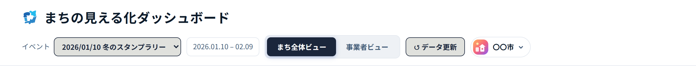

画面上部に固定表示（sticky）。全ビュー共通。左から順に：

| 要素 | id | 挙動 |
|---|---|---|
| ロゴ＋タイトル | `.brand` | 「まちの見える化ダッシュボード」。ロゴは `logo.png` |
| イベント選択 | `#eventSel` | プルダウン。選択すると全データが切り替わる（`setEvent()`） |
| 期間表示 | `#periodDisplay` | 選択中イベントの開催期間。表示専用でクリック不可 |
| 「まち全体ビュー」 | `#btnGov` | モード切替トグル。押した側が濃色（`aria-pressed`） |
| 「事業者ビュー」 | `#btnBiz` | 同上 |
| 「↺ データ更新」 | `#btnRefresh` | **未実装**（§13.1） |
| アカウントボタン | `#acctBtn` | アバター＋組織名。押すとアカウントメニューを開閉 |

イベント選択時（`setEvent()`）の副作用：

- マップの期間指定をそのイベントの全期間にリセット、曜日フィルターを「全日」に戻す
- 店舗プルダウンの選択肢を入れ替える（同名の店舗があれば選択を維持）
- 参加者一覧の絞り込み・キーワード・ページを初期化する

### 4.2 アカウントメニュー

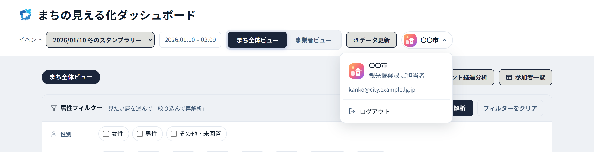

アカウントボタンを押すと開くポップオーバー（`#acctMenu`）。表示内容：

| 要素 | id | 内容（既定値） |
|---|---|---|
| 組織名 | `#acctOrg` | 〇〇市 |
| 担当者 | `#acctPerson` | 観光振興課 ご担当者 |
| メールアドレス | `#acctMail` | kanko@city.example.lg.jp |
| 「ログアウト」 | `#btnLogout` | 認証状態を破棄してログイン画面へ |

- 表示値は定数 `ACCOUNT`（`org` / `person` / `mail`）。**導入先の自治体に合わせてここを書き換える前提**
- メニュー外のクリック、または `Esc` キーで閉じる
- トップバーのボタンには組織名のみ表示する

### 4.3 モードバー

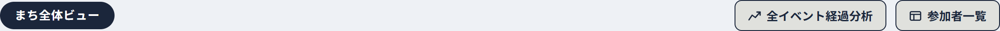

ダッシュボード本文の直前。現在地の表示と、別画面への入口。

| 要素 | id | 挙動 |
|---|---|---|
| ビュー名バッジ | `#modebadge` | まち全体ビュー＝濃紺、事業者ビュー＝ピンク（`.modebadge.biz`） |
| 店舗プルダウン | `#modeStoreSel` | **事業者ビューのときだけ表示**（`#modeStoreWrap`） |
| 「全イベント経過分析」 | `#btnHistory` | §8 の画面へ |
| 「参加者一覧」 | `#btnList` | §9 の画面へ |

> 右側2ボタンは**どちらのビューでも表示される**。これは設計意図と食い違っている（§13.2）。

### 4.4 属性フィルター

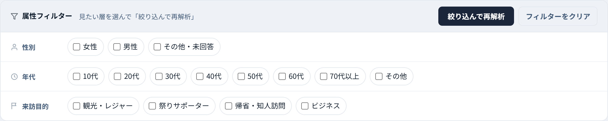

`#attrFilterDash`。ダッシュボードと全イベント経過分析で共通。参加者一覧には別の絞り込みUIがある（§9.3）。

**構成**（`filterGroupsHTML()` が生成）：

- ヘッダー行：「属性フィルター」＋ヒント「見たい層を選んで『絞り込んで再解析』」＋操作ボタン2つ
- 本体：カテゴリごとに1行（アイコン＋ラベル＋選択数バッジ＋チェックボックス群）

**選択肢**：

| カテゴリ | 内部キー | 選択肢 |
|---|---|---|
| 性別 | `gender` | 女性 / 男性 / その他・未回答 |
| 年代 | `age` | 10代 / 20代 / 30代 / 40代 / 50代 / 60代 / 70代以上 / その他 |
| 来訪目的 | `purpose` | 観光・レジャー / 祭りサポーター / 帰省・知人訪問 / ビジネス |

**操作ボタン**：

| ボタン | class | 挙動 |
|---|---|---|
| 「絞り込んで再解析」 | `.btn-apply-filters` | 保留中の条件を確定し、全パネルを再計算 |
| 「フィルターをクリア」 | `.btn-reset-filters` | 保留中・適用中の両方を空にして全データ表示に戻す |

**適用は2段階**。チェックを入れただけでは画面は変わらない。

| 操作 | 結果 |
|---|---|
| チェックを入れる／外す | `pendingFilters` が変わるだけ。数値は変化しない |
| 「絞り込んで再解析」を押す | `currentFilters = pendingFilters` となり再描画 |
| 「フィルターをクリア」を押す | 両方を空にして再描画 |
| ビューを切り替える | 適用中の条件は維持される |

**条件の組み合わせ**：

| 組み合わせ | 扱い | 例 |
|---|---|---|
| 同じカテゴリ内 | OR | 「20代」＋「30代」→ 20代または30代 |
| 異なるカテゴリ間 | AND | 「女性」＋「20代」→ 20代の女性 |

**計算方式（重要）**：

個々のログを条件で抽出しているのではなく、**集計済みの数値に該当構成比を掛けてスケーリングする近似方式**（`computeFilterFactor()` / `applyFilterScaling()`）。

1. カテゴリごとに、選択した選択肢の構成比を合算する
2. カテゴリ間はそれらを掛け合わせる
3. 得られた係数を各集計値に掛ける

性質：

- 絞り込み後の数値は**実際の該当人数と厳密には一致しない**
- 係数には下限 `0.02`（2%）があり、それ以下にはならない
- 各数値には最小値 `1` が設定されており、0にはならない

> プロトタイプとしては成立しているが、本番データ接続時は**個票を条件で抽出する方式に置き換える必要がある**。

スケーリングの対象：`spotHeat` / `daily` / `flow` / `heat` / `rows` / `timeSlots` / `funnel`。

---

## 5. 認証（ダミー）

実際の認証・認可は一切行っていない。画面と遷移だけを用意した状態。

### 5.1 ログイン

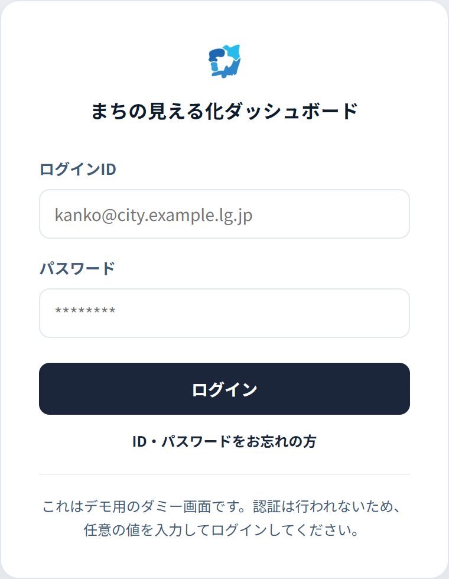

`#loginForm`。ロゴ、タイトル、入力欄2つ、ボタン、注記で構成。

| 要素 | id | 内容 |
|---|---|---|
| ログインID | `#loginId` | プレースホルダ `kanko@city.example.lg.jp` |
| パスワード | `#loginPw` | `type="password"` |
| 「ログイン」 | — | submit |
| 「ID・パスワードをお忘れの方」 | `#btnForgot` | 再設定画面へ |
| エラー | `#loginError` | 「ログインIDとパスワードを入力してください。」 |
| 注記 | `.login-note` | 「これはデモ用のダミー画面です。認証は行われないため、任意の値を入力してログインしてください。」 |

**挙動**：IDとパスワードが**どちらも空でなければ通す**。値の照合も保存もしない。成功時に `localStorage` の `rokamap_auth` に `'1'` を書き込む。

### 5.2 ID・パスワード再設定

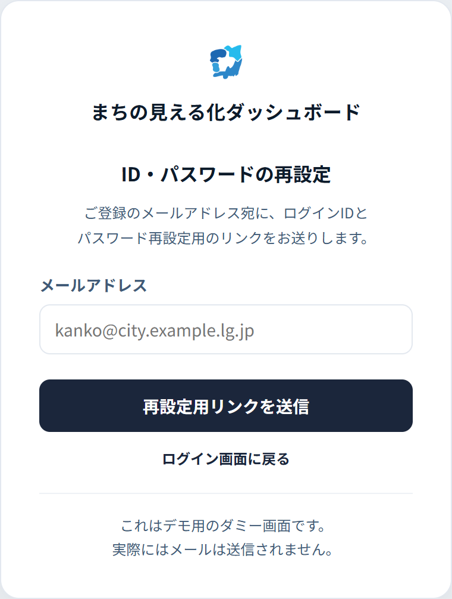

`#resetForm`。見出し「ID・パスワードの再設定」、説明「ご登録のメールアドレス宛に、ログインIDとパスワード再設定用のリンクをお送りします。」

| 要素 | id | 内容 |
|---|---|---|
| メールアドレス | `#resetMail` | `type="email"` |
| 「再設定用リンクを送信」 | — | submit |
| 「ログイン画面に戻る」 | `#btnBackToLogin` | ログイン画面へ |
| エラー | `#resetError` | 「メールアドレスを入力してください。」 |

**挙動**：空欄チェックのみ。**メール送信も保存も行わない**。

### 5.3 送信完了

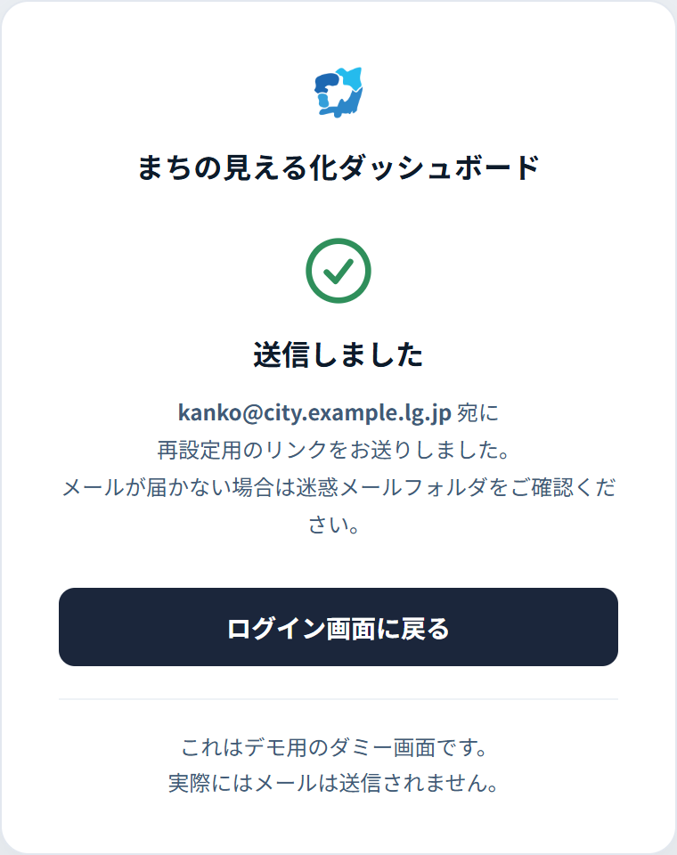

`#resetDone`。見出し「送信しました」。入力されたアドレス（`#resetSentTo`）を本文に差し込み、「メールが届かない場合は迷惑メールフォルダもご確認ください」と案内する。「ログイン画面に戻る」（`#btnDoneBack`）のみ。

### 5.4 認証状態の管理

| 項目 | 内容 |
|---|---|
| 保存先 | `localStorage` のキー `rokamap_auth`（定数 `AUTH_KEY`） |
| ログイン済みの判定 | `isLoggedIn()` が `'1'` を返すか |
| ログアウト | `removeItem` してログイン画面を表示 |
| 例外処理 | プライベートブラウズ等で `localStorage` が使えない場合も**例外を握りつぶしてダッシュボードは動く**（ただし未ログイン扱いになる） |

未ログイン時は `body` に `.logged-out` が付き、`.topbar` / `main` / `#histView` / `#listView` を `display:none` にする。背後へのタブ移動も防ぐ。

> 本ツールは **`localStorage` を使用している**。認証状態の保持が唯一の用途。

### 5.5 アカウント種別と閲覧範囲（権限モデル）

**この節は仕様。プロトタイプには未搭載（§13.2）。** ログインしたアカウントの種別によって、見えるビューと対象店舗が決まる。

| アカウント種別 | ログイン直後の表示 | ビューの切替 | 閲覧できるデータ |
|---|---|---|---|
| 自治体 | まち全体ビュー | 両ビューを自由に切替。事業者ビューでは店舗プルダウンで全店舗を横断して閲覧できる | まち全体の全データ、全店舗の事業者ビュー、全イベント経過分析、参加者一覧 |
| 事業者 | 自店の事業者ビュー | 切替不可。まち全体ビューには入れない | 自店のデータのみ。これに加えて §7.4「まち全体の参考値」（時間帯構成という粒度のみ）を参照できる |

原則：

1. **事業者は自店のデータしか見られない。** 他店の個別数値、まち全体の集計、全イベント経過分析、参加者一覧はいずれも対象外。
2. **自店の数字も他店からは見えない。** 事業者間でデータが相互に見えないことが、店舗に参加してもらう前提になっている。
3. **全店舗を横断して見られるのは自治体だけ。** これは自治体が個店へデータを還元するための権限（例：遠方からの来訪が多いスポットの運営者に、その事実をデータを添えて伝える）。自治体がまちの事業者を支援する立場にあることが根拠。
4. **参加者一覧とCSV出力は自治体のみ。** 参加者を1人1行の粒度で持ち出せるため、事業者には開放しない。
5. 事業者アカウントには `ACCOUNT` に相当する所属店舗の情報が必要になる。現在の `ACCOUNT` 定数（`org` / `person` / `mail`）には種別も店舗の概念もない。

> 満たしたいのは上の原則1〜4。事業者アカウントで「ビュー切替」「全イベント経過分析」「参加者一覧」を非表示にするか、表示したうえで無効化して理由を添えるかは、実装の都合に合わせて構わない。

---

## 6. まち全体ビュー

自治体職員向け。起動時の既定表示。全スポット・全データを閲覧できる。

### 6.1 構成

上から順に：

| 順 | ブロック | id | 内容 |
|---|---|---|---|
| 1 | 結論一行 | `#headline` | 参加人数・県外比率・平均周遊スポット数を一文で要約 |
| 2 | AIによる提案 | `#aiTipBox` | 施策案の提示と関連事例（§6.2） |
| 3 | スポット別来訪マップ | `#mapSection` | 地図上の来訪量と周遊ルート（§6.3） |
| 4 | 詳細を見る | `#btnDetailToggle` | 折りたたみ。個人ジャーニーとスポット別来訪者表（§6.4） |
| 5 | セクション1　来訪者サマリー | `#carte` 他 | カルテ4枚／流入元／来訪者プロファイル（§6.5） |
| 6 | セクション2　回遊の流れ | `#pFlow` | 人気の導線（§6.6） |
| 7 | セクション3　来訪の傾向 | `#pTrend` 他 | 日次トレンド／曜日×時間帯（§6.7） |

### 6.2 結論一行とAIによる提案

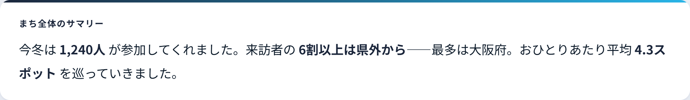

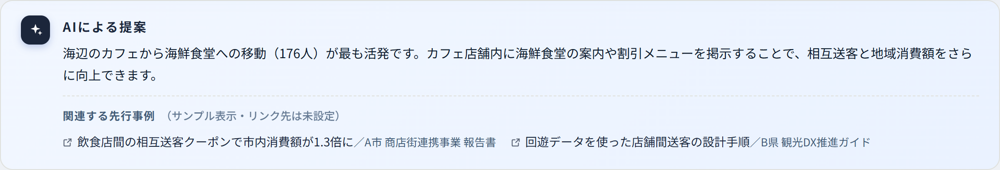

- **結論一行**：見出しに「まち全体のサマリー」（事業者ビューでは店舗名）。本文は「今冬は 1,240人 が参加してくれました。来訪者の 6割以上は県外から──最多は大阪府。おひとりあたり平均 4.3スポット を巡っていきました。」のような一文。数値は強調表示
- **AIによる提案**：数値から導いた施策案を一文で提示。下段に「関連する先行事例」として他自治体の事例名が並ぶ。**「（サンプル表示・リンク先は未設定）」と画面に明記**されており、リンク先は未設定（§13.1）

#### 先行事例リンクの仕様

プロトタイプではアンカーに `href="#"` と `onclick="return false;"` が入っており、押しても何も起きない。仕様は次のとおり。

データは `aiRefs` 配列。各要素のキー：

| キー | 内容 | 必須 |
|---|---|---|
| `t` | 事例のタイトル | 必須 |
| `o` | 出典元（自治体名・レポート名など） | 必須 |
| `url` | 事例ページのURL | 任意。無ければリンクにしない |
| `year` | 公開年（西暦4桁） | 任意 |

表示と挙動：

- `url` を持つ要素は `<a href="{url}" target="_blank" rel="noopener noreferrer">` にする
- `url` を持たない要素は**リンクにせず**、同じ見た目のまま押せないテキストとして出す（押せそうに見せない）
- `aiRefs` が空、または `url` を持つ要素が1件もない場合は「関連する先行事例」のブロックごと出さない
- `url` を持つ要素が1件以上あれば、注記「（サンプル表示・リンク先は未設定）」を外す
- 外部サイトへ遷移することが分かるよう、既存の外部リンクアイコン（`AI_LINK_SVG`）は残す

内容の条件：

- **実在する公開ページのみ。** 自治体・公的機関・業界団体の公開資料を優先する
- リンク切れに備え、`year` と `o`（出典元）を画面に併記する。リンクが切れても何を指していたかが残る
- 事例は提案文（`aiTip`）の根拠として並ぶため、提案内容と対応しない事例を混ぜない
- 1提案あたり **1〜3件**。それ以上は結論一行の簡潔さを損なう
- 事例に地名が含まれる場合、§14 の「地名を画面に出さない」は**自分のまちの地名**を指す。他自治体の事例名は出してよい（現状の `aiRefs` も「H町」のように伏せているが、実在事例に差し替える際は出典として正式名称を出す）

### 6.3 スポット別来訪マップ

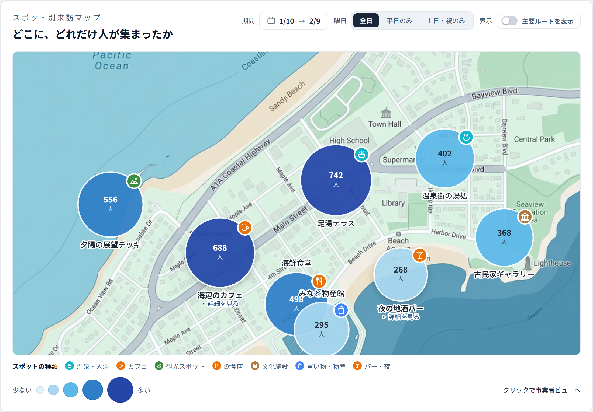

本ビューの中心となるパネル。ヘッダーに独立した3つのコントロールがある。

| コントロール | id | 操作 | 効果 |
|---|---|---|---|
| 期間 | `#drpTrigger` / `#drpCal` | カレンダーで開始日と終了日を指定 | マップの集計対象期間を絞る |
| 曜日 | `#dayFilter` | 「全日」/「平日のみ」/「土日・祝のみ」 | 曜日で集計対象を絞る |
| 表示 | `#routeSwitch` | 「主要ルートを表示」スイッチ | ONで周遊ルートの線を重ねる |

「期間」と「曜日」は別々のコントロールで、両方を同時に指定できる。

**バブルの読み方**：

- 円の大きさと濃さが来訪者数を表す（凡例「少ない → 多い」、5段階）
- 円の右上のアイコンがスポットの種類を表す
- 店舗データを持つスポットには「▸ 詳細を見る」が表示され、**クリックすると事業者ビューへ遷移**する
- マップ右下に「クリックで事業者ビューへ」のヒント

**スポットの種類**（`SPOT_CAT`、Googleマップの配色慣習に寄せた色分け）：

| キー | ラベル | 色 |
|---|---|---|
| `onsen` | 温泉・入浴 | `#12B5CB` |
| `cafe` | カフェ | `#E8710A` |
| `food` | 飲食店 | `#E8710A` |
| `bar` | バー・夜 | `#E8710A` |
| `view` | 観光スポット | `#3C8D40` |
| `culture` | 文化施設 | `#B07C3E` |
| `shopping` | 買い物・物産 | `#4285F4` |

マップ下に「スポットの種類」凡例（`#catLeg`）を表示する。

**スポット一覧**（`SPOT_DATA`、8か所）：

| スポット | 種類 | 第1回の来訪者数 | 店舗データ |
|---|---|---|---|
| 足湯テラス | 温泉・入浴 | 742 | — |
| 海辺のカフェ | カフェ | 688 | あり |
| 夕陽の展望デッキ | 観光スポット | 556 | — |
| 海鮮食堂 | 飲食店 | 498 | — |
| 温泉街の湯処 | 温泉・入浴 | 402 | — |
| 古民家ギャラリー | 文化施設 | 368 | — |
| みなと物産館 | 買い物・物産 | 295 | — |
| 夜の地酒バー | バー・夜 | 268 | あり |

**主要ルートの重ね表示**：

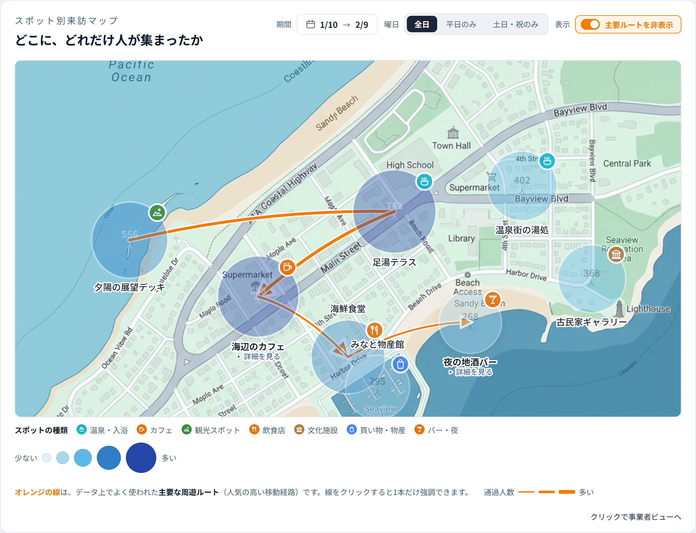

- スイッチをONにするとオレンジ（`#F57C00`）の線が重なり、バブルは薄くなる。ラベルとカテゴリアイコンははっきり残る
- ONの間、スイッチの文字は「主要ルートを非表示」に変わる
- 線の太さが通過人数を表す
- **線をクリックすると、その1本だけを強調表示**できる（強調色 `#C2410C`）
- 凡例「オレンジの線は、データ上でよく使われた主要な周遊ルート（人気の高い移動経路）です。線をクリックすると1本だけ強調できます。」

> バブル表示とルート表示は**二者択一ではない**。ルートはバブルの上に重ねるオーバーレイ。

### 6.4 詳細を見る（折りたたみ）

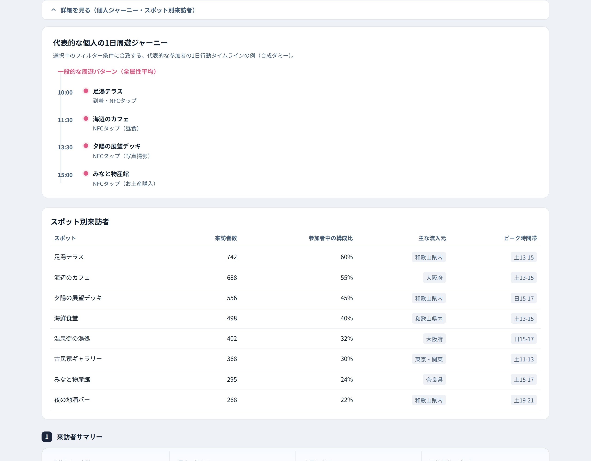

マップの下の「詳細を見る（個人ジャーニー・スポット別来訪者）」（`#btnDetailToggle`）を押すと展開する。既定では閉じている。**まち全体ビュー・事業者ビューのどちらにも表示される**。

展開すると2つのパネルが現れる。

**(1) 代表的な個人の1日周遊ジャーニー**（`#timelineSection`）

参加者1人の1日の動きを、時刻つきのタイムラインで示す。説明文に「選択中のフィルター条件に合致する、代表的な参加者の1日行動タイムラインの例（合成ダミー）。」と明記。

- 実在の個人ではなく**合成したダミー**
- イベントごとに4パターンのペルソナを保持（`individualJourneys`）
  - 一般的な周遊パターン（全属性平均）
  - 30代女性・観光目的のパターン
  - 祭りサポーター（関係人口）のパターン
  - 40代ファミリーの周遊パターン
- 属性フィルターの条件に最も合致するものを `pickJourney()` が選ぶ。条件に合うものが無ければ先頭を使う
- 各行は「時刻／スポット名／行動（例：NFCタップ（昼食））」

> プライバシー要件を満たすための設計。実データ接続時も**実在個人の行動履歴をそのまま出さないこと**。

**(2) スポット別来訪者**

| 列 | 内容 |
|---|---|
| スポット | スポット名 |
| 来訪者数 | 実数 |
| 参加者中の構成比 | % |
| 主な流入元 | 居住地（チップ表示） |
| ピーク時間帯 | 曜日＋時間帯（例：土13-15） |

### 6.5 セクション1　来訪者サマリー

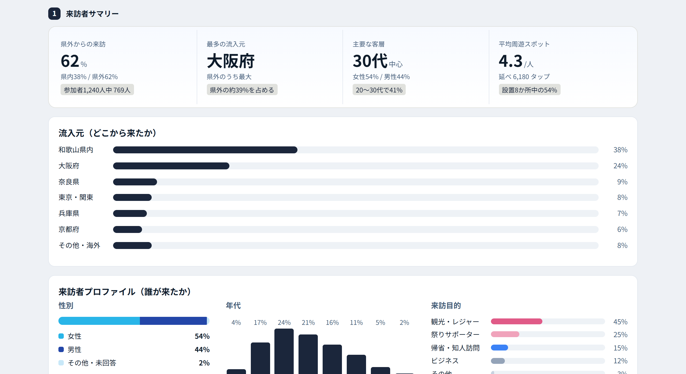

**カルテ（4枚のKPIカード、`#carte`）**：

| ラベル | 値（第1回） | 補足 | バッジ |
|---|---|---|---|
| 県外からの来訪 | 62% | 県内38% / 県外62% | 参加者1,240人中 769人 |
| 最多の流入元 | 大阪府 | 県外のうち最大 | 県外の約39%を占める |
| 主要な客層 | 30代中心 | 女性54% / 男性44% | 20〜30代で41% |
| 平均周遊スポット | 4.3/人 | 延べ 6,180 タップ | 設置8か所中の54% |

**流入元（どこから来たか）**（`#pInflow`）：居住地ごとの構成比を横バーで表示。

**来訪者プロファイル（誰が来たか）**（`#pDemo`）：3列構成。

- 性別：積み上げバー＋凡例（女性54% / 男性44% / その他・未回答2%）
- 年代：縦棒グラフ（8区分、各棒の上に%を表示）
- 来訪目的：横バー（観光・レジャー45% / 祭りサポーター25% / 帰省・知人訪問15% / ビジネス12% / その他3%）

### 6.6 セクション2　回遊の流れ

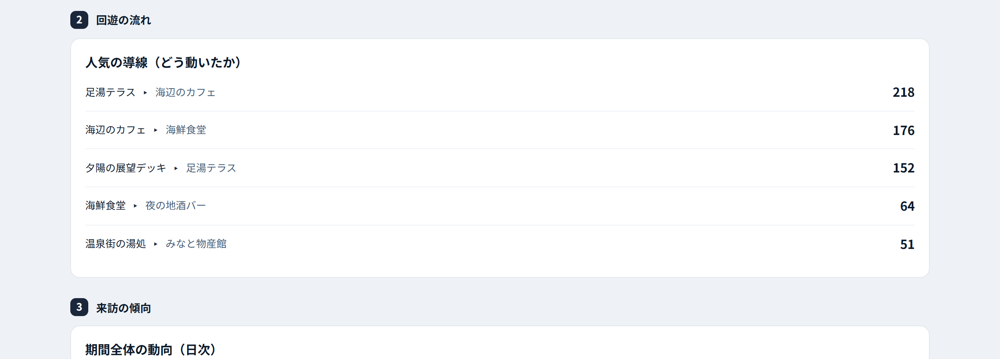

**人気の導線（どう動いたか）**（`#pFlow`）：スポット間の遷移を「A ▸ B　人数」の形でランキング表示する。

例（第1回）：足湯テラス▸海辺のカフェ 218／海辺のカフェ▸海鮮食堂 176／夕陽の展望デッキ▸足湯テラス 152／海鮮食堂▸夜の地酒バー 64／温泉街の湯処▸みなと物産館 51

> 事業者ビューではこのセクションの見出しが「関連目的地」に変わり、表示パネルも入れ替わる（§7.2）。

### 6.7 セクション3　来訪の傾向

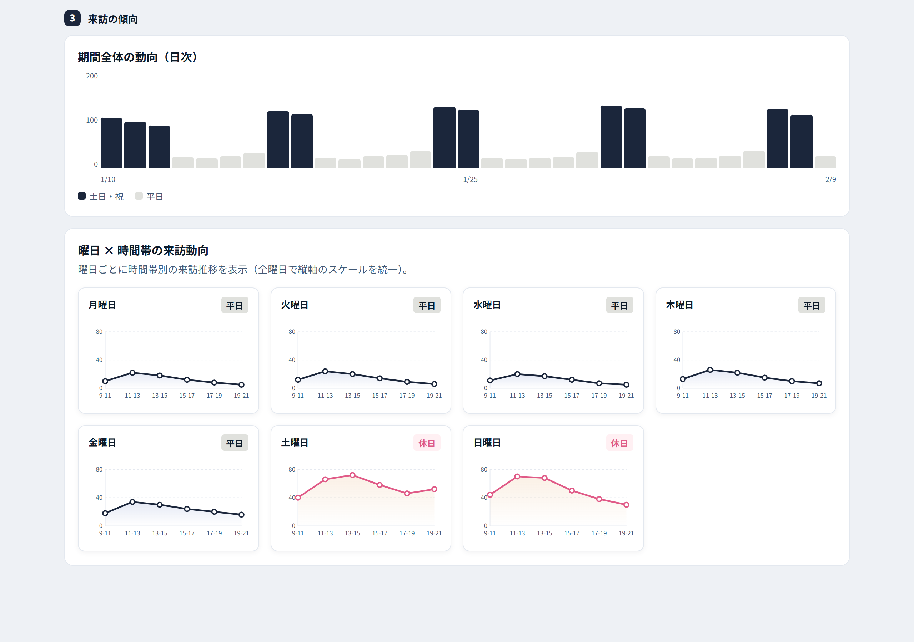

**(1) 期間全体の動向（日次）**（`#pTrend`）

イベント期間の日次参加者数を棒グラフで表示。土日・祝を濃色、平日を淡色で塗り分ける。凡例あり。縦軸は `#trendY`、横軸は `#trendX`（開始日・中間日・終了日）。

**(2) 曜日 × 時間帯の来訪動向**（`#heatLineCharts`）

説明「曜日ごとに時間帯別の来訪推移を表示（全曜日で縦軸のスケールを統一）。」

- 曜日ごとに**小さな折れ線グラフを7枚**並べる
- 各グラフの右上に「平日」または「休日」のバッジ（休日はピンク）
- 時間帯は 9-11 / 11-13 / 13-15 / 15-17 / 17-19 / 19-21 の6区分
- 全曜日で縦軸のスケールを統一しているため、曜日間の大小を直接比較できる

---

## 7. 事業者ビュー

参加店舗向け。表示されるのは自店のデータのみで、他店やまち全体の数字は見えない。逆に、自店の数字が他店から見えることもない。

自治体アカウントは店舗プルダウンで全店舗の事業者ビューを横断して閲覧できる（§5.5）。個店へデータを還元するための権限で、事業者側には無い。

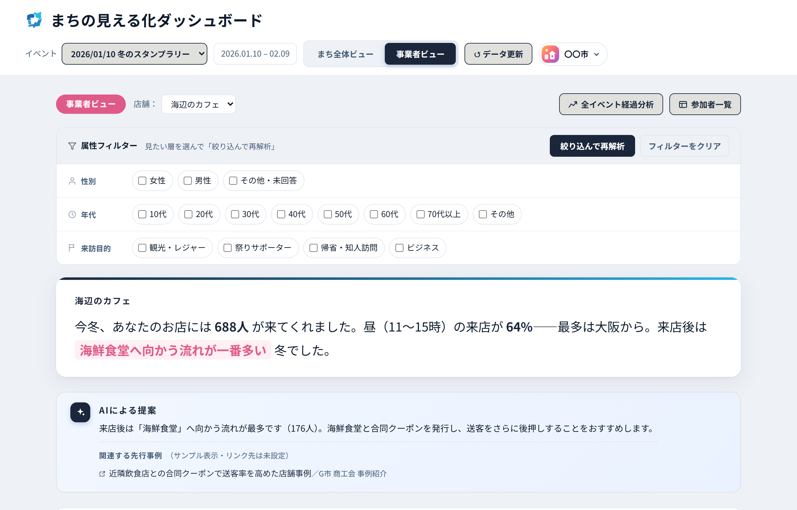

### 7.1 データの作られ方

`setMode('biz')` が、まち全体データに店舗別データを上書きしてマージする。日次データだけは店舗ごとの係数 `factor` を掛けて算出する。

店舗は現在2件のみ：**海辺のカフェ** / **夜の地酒バー**

### 7.2 まち全体ビューとの違い

| 項目 | まち全体ビュー | 事業者ビュー |
|---|---|---|
| ビュー名バッジ | 「まち全体ビュー」（濃紺） | 「事業者ビュー」（ピンク） |
| 店舗プルダウン | なし | モードバーに表示 |
| スポット別来訪マップ（`#mapSection`） | 表示 | **非表示（パネルごと消える）** |
| スポット別ヒートマップ（`#pSpotHeat`） | 非表示 | 「自店の客が『ほかに』巡ったスポット」を表示 |
| 人気の導線（`#pFlow`） | 「人気の導線（どう動いたか）」 | 「自店の前後に寄られたスポット」 |
| セクション2の見出し | 「回遊の流れ」 | 「関連目的地」 |
| まち全体の参考値（`#townRefSection`） | なし | 表示（既定では折りたたみ） |
| 結論一行 | まち全体の要約 | 自店の要約 |
| カルテ | 県外比率など | 自店への来訪／ピーク時間帯／主要な客層／送客先トップ |
| 流入元の見出し | 「流入元（どこから来たか）」 | 「自店の流入元」 |

### 7.3 自店の客が「ほかに」巡ったスポット

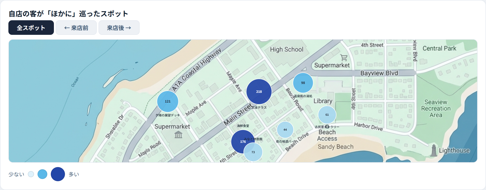

`#pSpotHeat` 内の `#spotBizMap`。自店以外のスポットへの送客・被送客を地図上のバブルで表示する。

パネル上部に3つの切替タブ（`#bizMapTabs`）：

| タブ | 値 | 内容 |
|---|---|---|
| 「全スポット」 | `all` | 自店の客が巡った全スポット |
| 「← 来店前」 | `before` | 自店に来る前に寄られたスポット |
| 「来店後 →」 | `after` | 自店の後に向かったスポット |

### 7.4 まち全体の参考値

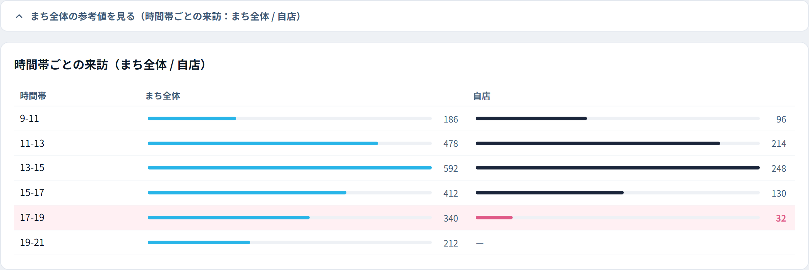

`#townRefSection`。「まち全体の参考値を見る（時間帯ごとの来訪：まち全体 / 自店）」（`#btnTownRef`）を押すと展開する。既定では閉じている。

展開すると「時間帯ごとの来訪（まち全体 / 自店）」の比較表が出る。時間帯6区分それぞれについて、まち全体（水色バー）と自店（濃紺バー）を左右に並べる。自店が弱い時間帯はピンクで強調する。

> まち全体の**時間帯構成という粒度の参考値のみ**を事業者に見せる設計。他店の個別数値は出していない。

### 7.5 自店のろか指標ファネル

事業者ビューには、自店を起点とした3段のファネルを表示する。各店舗の `funnel` 配列にデータが入っており、描画関数 `renderCh2(funnel, note)` も用意してある。プロトタイプではこの関数を呼んでいないため画面に出ていないが、呼べば表示される。

| 段 | ラベル | 定義 | 海辺のカフェ | 夜の地酒バー |
|---|---|---|---|---|
| 1 | 自店に来訪 | 自店のNFCを押した参加者 | 688人 | 268人 |
| 2 | 自店からじっくり周遊 | 自店に来たうえで3スポット以上巡った人 | 362人 | 121人 |
| 3 | 自店起点の関係人口の芽 | 自店来訪後に通知ON・フォロー・再訪に至った人（寄与） | 41人 | 19人 |

（値は第1回のもの。第2回・第3回も同じ構造で定義されている）

段に添える注記は各店舗の `ch2note` にある。例：「初回は比較対象がないため『常連化』はまだ測れません。今回は**自店から41人の"芽"**が生まれました。第2回で、この人たちが本当に戻ってきたかを見ることで、**自店がまちのファンづくりに効いているか**が分かります。」

**なぜ事業者に見せるか**：事業者が翌年も協力するかを判断する材料として、「何人来たか」より「自店から何人がまちのファンになったか」のほうが効く。§1.2 に挙げた事業者側の目的に直結する指標である。

まち全体ビューにはこのパネルを置かない。まち全体のファネルは全イベント経過分析（§8.2）で3回分を並べて見せるため、単回のダッシュボードには重複して出さない。

表示位置はセクション2「関連目的地」の手前を想定している。他のパネルとの並びを見て変えても差し支えない。

---

## 8. 全イベント経過分析

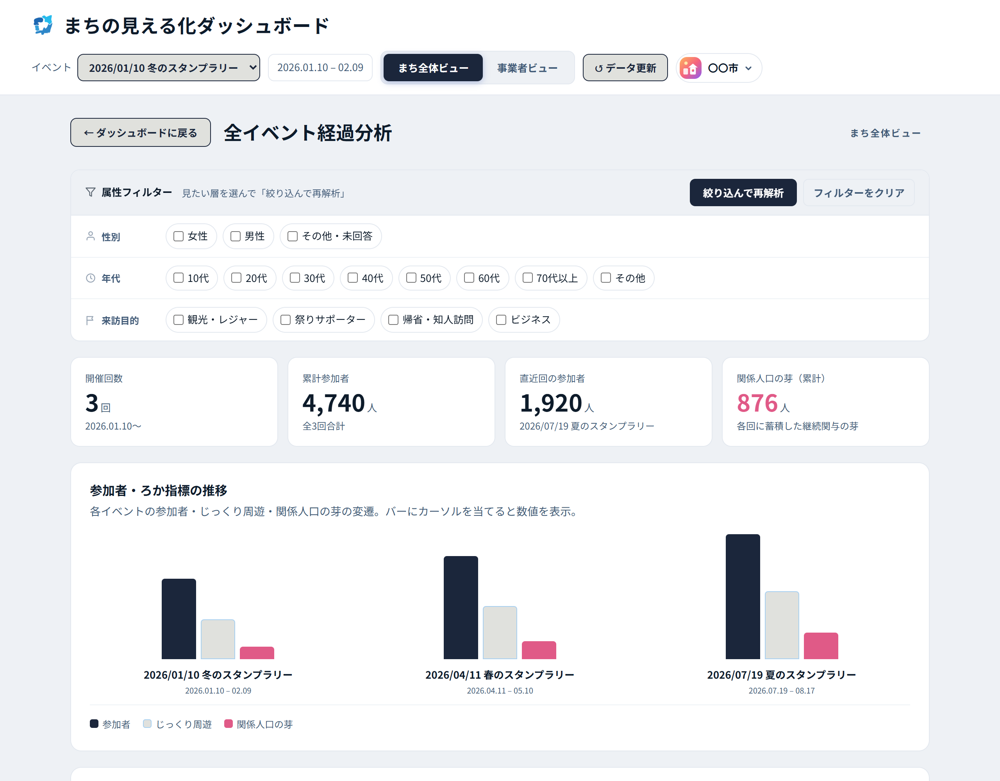

モードバーの「全イベント経過分析」で、ダッシュボードと入れ替わる形で全画面表示される。左上の「← ダッシュボードに戻る」（`#btnHistBack`）で戻る。

画面右上に「まち全体ビュー」のバッジが常に出る（**事業者ビューから来た場合も**。§13.2）。

### 8.1 構成

| ブロック | 内容 |
|---|---|
| 属性フィルター | ダッシュボードと共通（§4.4） |
| サマリーKPI（4枚） | 開催回数／累計参加者／直近回の参加者／関係人口の芽（累計） |
| 参加者・ろか指標の推移 | イベントごとのグループ棒グラフ。バーにカーソルを当てると数値を表示 |
| ろか指標の詳細比較 | 指標を行、イベント回を列に取った表 |
| 関係人口の芽 — 回別の成長 | 水平バーで各回の「芽」の数を可視化 |

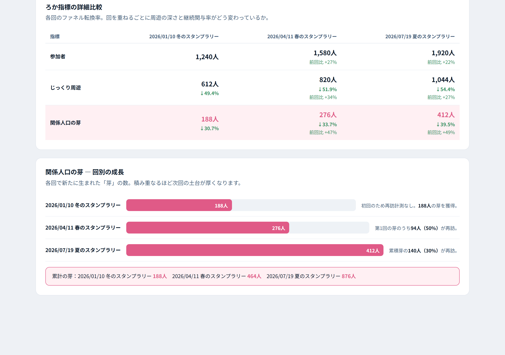

**サマリーKPIの値（フィルター未適用時）**：開催回数 3回／累計参加者 4,740人／直近回の参加者 1,920人／関係人口の芽（累計）876人

**ろか指標の詳細比較**：各セルに人数、前段からの転換率（↓%）、前回比（%）を並べて表示する。「関係人口の芽」の行はピンクの背景で強調する。

**関係人口の芽 — 回別の成長**：各回に再訪メモを添える。

- 第1回：初回のため再訪計測なし。188人の芽を獲得。
- 第2回：第1回の芽のうち94人（50%）が再訪。
- 第3回：累積芽の140人（30%）が再訪。
- 下部に累計（188 → 464 → 876人）

### 8.2 ろか指標ファネル

本ツールが最も伝えたい指標。3段構成で、段の間に転換率を表示する。

| 段 | 画面上のラベル | 定義 | 第1回の値 |
|---|---|---|---|
| 1 | 参加者 | ろかID登録＋NFCタップで参加した人。連絡可能な来訪者として獲得した母数 | 1,240人 |
| 2 | じっくり周遊 | 3スポット以上を巡った人。回遊の深さ | 612人 |
| 3 | 関係人口の芽 | 通知ON・フォロー・期間中の再訪のいずれかに至った人 | 188人 |

**まち全体のファネルが描画されるのはこの画面だけ**。単回のまち全体ビューには表示されない。3回分を並べて初めて意味が出る指標のため。

店舗を起点とした同じ3段のファネルは、事業者ビューに表示する（§7.5）。

---

## 9. 参加者一覧

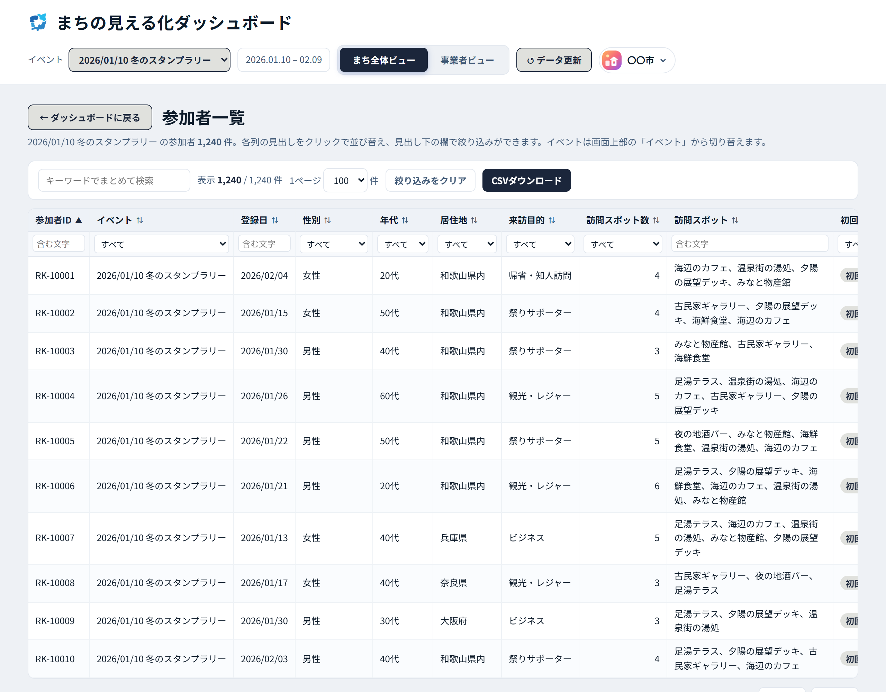

モードバーの「参加者一覧」で全画面表示される。選択中のイベントの参加者を1人1行で並べた表。左上の「← ダッシュボードに戻る」（`#btnListBack`）で戻る。

説明文：「◯◯の参加者 1,240 件。各列の見出しをクリックで並び替え、見出し下の欄で絞り込みができます。イベントは画面上部の『イベント』から切り替えます。」

### 9.1 列定義（`LIST_COLS`）

| # | 列 | キー | 型 | 内容 |
|---|---|---|---|---|
| 1 | 参加者ID | `id` | text | `RK-10001` 形式の仮ID。個人名は表示しない |
| 2 | イベント | `event` | select | 参加した回 |
| 3 | 登録日 | `regDate` | text | ろかIDの登録日（YYYY/MM/DD） |
| 4 | 性別 | `gender` | select | 属性フィルターと同じ区分 |
| 5 | 年代 | `age` | select | 同上 |
| 6 | 居住地 | `area` | select | 同上 |
| 7 | 来訪目的 | `purpose` | select | 同上 |
| 8 | 訪問スポット数 | `spotCnt` | number | 1〜8 |
| 9 | 訪問スポット | `spots` | text | スポット名を「、」で連結 |
| 10 | 初回/再参加 | `repeat` | select | 「初回」または「再参加」をチップ表示 |
| 11 | 通知 | `notify` | select | ON / OFF をチップ表示 |

### 9.2 データの生成（`buildParticipants()`）

実データではなく、集計値から**決定論的に合成**している。

- 件数はそのイベントのファネル1段目（参加者数）と一致
- 乱数は固定シード（`mulberry32(20260629 + evIdx * 7919)`）。**何度開いても同じ結果**になる
- 属性は `demo` の構成比に従って重み付き抽選
- 訪問スポットは `spotHeat` の重みで抽選。件数は平均周遊スポット数の前後にばらつかせ、1〜8に収める
- 「再参加」の比率はイベント回ごとに 0% / 18% / 30%（第1回は過去がないため全員「初回」）
- 通知ON率は `関係人口の芽 ÷ 参加者 + 0.08`（上限60%）
- 生成結果は `listCache` にイベント単位でキャッシュする

### 9.3 操作

| 操作 | 要素 | 内容 |
|---|---|---|
| 並び替え | 列見出し `.lv-sort` | クリックで昇順／降順を切り替え。現在の列に ▲▼、他は ⇅ を表示 |
| 列ごとの絞り込み | 見出し下の欄 | 選択式の列はプルダウン（「すべて」＋実在値）、自由入力の列はテキスト（「含む文字」で部分一致） |
| キーワード検索 | `#lvQuery` | 「キーワードでまとめて検索」。全列を横断して絞り込む |
| 表示件数 | `#lvPageSize` | 50 / 100 / 200 / 500 |
| ページ送り | `#lvPrev` / `#lvNext` | 「← 前へ」「次へ →」。右下に「n / m ページ」 |
| 件数表示 | `.lv-count` | 「表示 1,240 / 1,240 件」 |
| 絞り込みをクリア | `.lv-btn` | 列ごとの絞り込みとキーワード検索をまとめて解除 |
| CSVダウンロード | `#lvCsv` | 絞り込み後の全行を書き出す |

該当0件のときは「条件に一致する参加者はいません。」と表示する。

### 9.4 CSV出力（`exportListCsv()`）

| 項目 | 内容 |
|---|---|
| ファイル名 | `participants_<イベントid>.csv` |
| 文字コード | **BOM付きUTF-8**（Excelで開いたときに文字化けしないため） |
| 改行 | CRLF |
| 引用 | 全フィールドをダブルクォートで囲み、内部の `"` は `""` にエスケープ |
| 対象行 | **画面の絞り込み後の全行**（表示中のページだけではない） |
| ヘッダー | `LIST_COLS` のラベル |

### 9.5 粒度についての注意

ほかの画面はすべて集計値だが、**この画面だけ参加者を1人1行で並べる**。個人名や生年月日は出さず仮IDに置き換えているが、性別・年代・居住地・訪問スポットが1行に揃うため、他画面より個人が特定されやすい形式になる。CSVで手元に持ち出せる点も含め、誰にこの画面を開かせるかは運用ルールとあわせて決める必要がある（§13.2）。

---

## 10. 指標・データ定義

### 10.1 イベント（`EVENTS`）

| # | ラベル | 期間 | 参加者 | じっくり周遊 | 関係人口の芽 |
|---|---|---|---|---|---|
| 1 | 2026/01/10 冬のスタンプラリー | 2026.01.10 – 02.09 | 1,240 | 612 | 188 |
| 2 | 2026/04/11 春のスタンプラリー | 2026.04.11 – 05.10 | 1,580 | 820 | 276 |
| 3 | 2026/07/19 夏のスタンプラリー | 2026.07.19 – 08.17 | 1,920 | 1,044 | 412 |

各イベントは `{ id, label, period, evtStart, evtDays, gov, stores }` を持つ。`activeEventIdx` が選択中の回、`activeEvent()` がそのオブジェクトを返す。

### 10.2 まち全体データ（`gov`）の主なキー

| キー | 形 | 内容 |
|---|---|---|
| `funnel` | `[{cap, n, unit, def}]` | ろか指標3段 |
| `carte` | `[{cl, cv, u, cs, bm}]` | KPIカード4枚（ラベル／値／単位／補足／バッジ） |
| `daily` | `number[]` | 日次参加者数（`evtDays` 個） |
| `spotHeat` | `[[スポット名, 人数]]` | スポット別来訪量 |
| `heat` | `number[7][6]` | 曜日×時間帯 |
| `timeSlots` | `[[時間帯, 人数]]` | 時間帯別（まち全体参考値用） |
| `inflow` | `[[地域名, %]]` | 流入元 |
| `demo` | `{gender, age, purpose}` | それぞれ `[[ラベル, %]]` |
| `flow` | `[{a, b, n, tag?}]` | 導線（A→B と人数） |
| `typicalRoutes` | `[{id, spots[], count, avgMinutes}]` | 主要ルート |
| `individualJourneys` | `[{name, gender, age, purpose, timeline[]}]` | 個人ジャーニー4パターン |
| `thead` / `rows` | `string[]` / `any[][]` | スポット別来訪者表 |
| `aiTip` | `string` | AI提案の本文 |
| `spotHeatTitle` / `flowTitle` / `inflowTitle` | `string` | パネル見出し（ビューで切り替わる） |

### 10.3 店舗データ（`stores`）

`stores[店舗名]` に同じ形の上書きデータと `factor`（日次スケール係数）を持つ。事業者ビューでは `Object.assign({}, gov, S)` でマージする。

---

## 11. デザイントークン

### 11.1 色（`:root` のCSS変数）

| 変数 | 値 | 用途 |
|---|---|---|
| `--bg` | `#eef1f5` | 地の背景 |
| `--card` | `#ffffff` | カード背景 |
| `--ink` | `#0D1B2A` | 本文 |
| `--ink-soft` | `#415A77` | 弱い文字 |
| `--line` | `#e3e8ef` | 罫線 |
| `--line-soft` | `#eef2f6` | 薄い罫線 |
| `--track` | `#eef2f6` | バーの軌道 |
| `--blue` | `#1B263B` | プライマリ（濃紺） |
| `--blue-d` | `#0D1B2A` | プライマリ濃 |
| `--blue-l` | `#E0E1DD` | プライマリ淡 |
| `--sakura` | `#E05A87` | 関係人口アクセント（ピンク） |
| `--sakura-bg` | `#FFF0F3` | 同背景 |
| `--amber` / `--amber-bg` | `--sakura` のエイリアス | 旧名。新規コードでは `--sakura` を使う |
| `--green` | `#2f8f5b` | 転換率 |
| `--route` | `#F57C00` | 主要ルートの線 |
| `--route-dk` | `#C2410C` | 強調中のルート |
| `--route-bg` | `#FFF4E5` | ルート関連の背景 |

> 関係人口のアクセントは**ピンク（桜）**。以前はアンバーだったが変更済み。`--amber` は後方互換のエイリアスとして残っている。

### 11.2 文字サイズ（役割ベースの9トークン）

**UIには12px未満を使わない。10pxはグラフ内部のみ。**

| 変数 | 値 | 用途 |
|---|---|---|
| `--fs-num` | `clamp(24px, 3vw, 30px)` | KPI・カルテの主役の数値 |
| `--fs-h1` | `clamp(20px, 2.6vw, 24px)` | 画面タイトル |
| `--fs-h2` | `clamp(17px, 2.2vw, 20px)` | セクション見出し |
| `--fs-h3` | `16px` | パネル・カードの見出し |
| `--fs-body` | `14px` | 本文、および箱のタイトル（太字と色で区別） |
| `--fs-ui` | `13px` | ボタン・タブ・フォーム・ピル・メニュー項目 |
| `--fs-note` | `12px` | 注釈・凡例・テーブル見出し・メタ情報 |
| `--fs-micro` | `10px` | グラフ内部のみ |
| `--fs-svg-axis` | `9px` | SVG viewBox 内のユーザー単位（画面実寸ではない） |

> 新しい文字サイズを足さず、**既存の9トークンから選ぶ**こと。

### 11.3 タイポグラフィとレイアウト

- 書体（`--sans`）：`"Inter", "Noto Sans JP", "Hiragino Kaku Gothic ProN", "Yu Gothic", YuGothic, "Helvetica Neue", Arial, sans-serif`
- 見出しは bold。数値は `font-variant-numeric: tabular-nums`
- 上部バーは sticky で固定
- カード型のグリッド（モバイルでは1カラム）

### 11.4 アクセシビリティ

- `focus-visible` でフォーカス位置の輪郭を表示
- `prefers-reduced-motion` を尊重
- トグル類には `aria-pressed`、メニューには `aria-haspopup` / `aria-expanded` / `aria-controls`、折りたたみには `aria-expanded` / `aria-controls` を付ける

---

## 12. 実装の前提

| 項目 | 内容 |
|---|---|
| 構成 | 単一HTML（約4,370行）。ビルド不要、バニラJS、外部ライブラリなし |
| 地図 | 背景は base64 埋め込みの画像、その上にSVG（`#mapSvg`、`viewBox="0 0 860 460"`）でバブルとルートを描画 |
| ブラウザストレージ | `localStorage` を認証状態の保持にのみ使用（`rokamap_auth`） |
| 数値 | **すべてダミー**。本番データには接続していない |
| 状態変数 | `mode`（`gov`/`biz`）、`activeEventIdx`、`currentFilters` / `pendingFilters`、`routeVisible`、`mapStartIdx` / `mapEndIdx` / `mapDayType`、`listSortKey` / `listColFilters` / `listQuery` / `listPage` / `listPageSize` |
| 主要関数 | `setMode()` / `setEvent()` / `paint()` / `applyFilterScaling()` / `computeFilterFactor()` / `renderMapSpots()` / `renderRoutes()` / `renderHistoryView()` / `renderListView()` / `buildParticipants()` / `pickJourney()` / `applyUrlState()` |
| 付属物 | `figma-export/` に各画面のHTMLエクスポート10点（01-login 〜 10-account-menu） |

---

## 13. 実装にあたっての補足

画面・操作・データの仕様は §1〜§12 で一通り揃っている。この章はその補足で、プロトタイプとしてダミーのままにしている箇所と、実装の都合に合わせて形を変えても差し支えない箇所をまとめてある。

### 13.1 プロトタイプとしてダミーのままにしている箇所

本ツールは**動くUIのプロトタイプ**で、データはすべてHTML内に書かれた固定値。したがって以下はダミーのままにしてある。ボタンや画面が存在し、押せば反応することを示す役割は果たしている。

| 箇所 | プロトタイプでの挙動 | 本番データ接続後の姿 |
|---|---|---|
| 「↺ データ更新」ボタン | 表示が「更新中…」に変わり、約1.2秒後に戻る | 最新ログを取得し、全パネルを再計算して再描画する |
| 認証（ログイン・再設定） | 空欄チェックのみ。照合も保存もせず、メールも送信しない | 認証基盤に接続する。画面と遷移の仕様は §5 に揃っている |
| 属性フィルターの絞り込み | 個票の抽出ではなく、集計値へのスケーリング近似（§4.4） | 個票抽出になる。近似値では集計と一致しないため |
| 全データ | ダミー値（§12） | 実データに差し替わる |

### 13.2 仕様として定めている箇所

プロトタイプには未搭載だが、仕様は本文に書いてある。

| 項目 | 仕様の所在 | プロトタイプでの状態 |
|---|---|---|
| アカウント種別と閲覧範囲（権限モデル） | §5.5 | 未搭載。誰でも両ビューに切り替えられ、`ACCOUNT` に種別も所属店舗の概念もない |
| AI提案の「関連する先行事例」のリンク | §6.2 | `href="#"` と `onclick="return false;"` が入っており押しても何も起きない。画面にも「（サンプル表示・リンク先は未設定）」と明記 |
| 自店のろか指標ファネル | §7.5 | データと描画関数はあるが、関数を呼んでいないため画面に出ない |

### 13.3 実装の都合に合わせて差し支えない箇所

以下は本書が意図だけを示している箇所。満たしたい条件は挙げてあるが、その先の形は現場に無理のないやり方で構わない。

| 箇所 | 満たしたい条件 | 備考 |
|---|---|---|
| 事業者アカウントで見せない画面の扱い | §5.5 の原則1〜4（事業者は自店のデータのみ。参加者一覧とCSVは自治体のみ） | 非表示にするか、表示して無効化し理由を添えるか。画面構成の変更を伴っても差し支えない |
| 自店ファネルの表示位置 | 事業者ビュー内に置く（§7.5） | パネルの並び順。セクション2の手前を想定しているが、他案でも差し支えない |
| 属性フィルターの個票抽出方式 | 絞り込み結果が集計値と一致する | サーバ側で集計するか、クライアント側で抽出するか。件数が増えた場合のページングや応答時間の設計 |
| データ更新の頻度と方式 | 「↺ データ更新」で最新になる | 手動のみか自動更新も入れるか、更新間隔、バッチの設計 |
| 認証基盤 | §5.5 の権限モデルを表現できる | 方式・製品の選定。`ACCOUNT` に種別と所属店舗を持たせる形にすれば足りる |
| 先行事例の登録・更新の運用 | §6.2 の条件（実在する公開資料のみ、1提案あたり1〜3件） | 登録のタイミング。管理画面を設けるか、コードに直接持たせるか |
| 少人数セグメントの伏せ方（k-匿名性） | §1.4 のプライバシー要件を満たす | しきい値の値、伏せていることの画面上の表し方 |

### 13.4 そのほか

§14 にまとめた事項は、過去の検討を経て方針が固まっているもの。それ以外の部分は、より良い形があれば取り入れていただいて差し支えない。

---

## 14. 禁止事項

いずれも過去の検討を経て方針が固まっている事項。

| 禁止事項 | 理由 |
|---|---|
| 地名を画面に出す | 特定の自治体名を出さない方針のため |
| 「リピーター」という語を使う | 飲食・小売の常連を指す語で、年に一度のイベントに再び参加した人を指すには意味が強すぎるため。該当する人は**「再参加」**と表記する（§9.1） |
| 個人名・生年月日を画面に表示する | プライバシー設計上の必須要件のため |
| ふるさと納税・EC転換のKPIを足す | 現段階ではスコープ外と判断されているため |
| 暗い背景のテーマに戻す | 明るい配色（白背景＋淡いグレーの地）で確定しているため |
| 新しい文字サイズを定義する | 役割ベースの9トークンに統一済みのため（§11.2） |
| UIに12px未満の文字を使う | 可読性のため。10pxはグラフ内部のみ |

### 文章表現の方針

提案先は自治体観光課の職員で、データの専門家ではない。画面上の文言は専門用語を避け、「平日の谷」「どこに流れたか」のような平易な言葉を保つこと。

---

## 15. 変更履歴

| 版 | 日付 | 主な変更 |
|---|---|---|
| 4.1 | 2026-11-17 | アカウント種別と閲覧範囲（§5.5）、先行事例リンク（§6.2）、自店のろか指標ファネル（§7.5）の仕様を確定。「リピーター」を「再参加」に統一（HTML・本書とも）。§13 を「実装にあたっての補足」として再編 |
| 4.0 | 2026-11-17 | ログイン・再設定・アカウントメニューを追加。配色を全面刷新（アクセントをアンバー→ピンク、プライマリを濃紺に）。文字サイズを役割ベースの9トークンに再定義。属性フィルターを行構造に整理。曜日×時間帯を折れ線7枚に変更。個人ジャーニーを4パターン＋フィルター連動に。URLパラメータによる画面指定を追加。Markdown化し、AIが読む前提で全面的に書き直し |
| 3.0 | 2026-08-11 | 参加者一覧を追加。スポットのカテゴリ表示を追加。マップの表示切替をスイッチ化。年代を8区分に |
| 2.1 | 2026-08-06 | ファネルの記述を実装に合わせ、「詳細を見る」の章を追加 |
| 2.0 | 2026-08-06 | 実画面のスクリーンショットを掲載し、実装との不整合を修正 |
| 1.0 | 2026-08-06 | 初版 |
